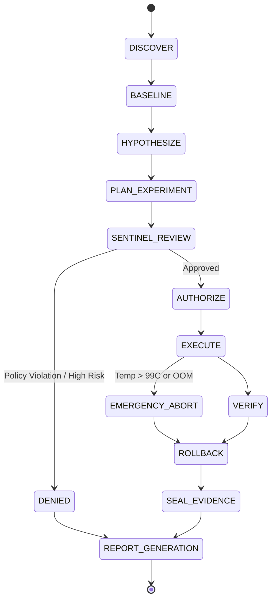

# Architecture Specification: Hardware Research Agent (IHRA)

> This document mixes an enforced design with a target architecture, and each section below says which is which. `core/executor.py` replays fixed synthetic fixtures and can run one pinned CPU-only workload inside a rootless Bubblewrap sandbox. `core/planning.py` parses inert, strict proposals that cannot change the only eligible plan. `core/authorization.py` requires a fresh, one-use confirmation on `/dev/tty` bound to the proposal and plan digests, with a monotonic expiry. This is local operator consent, not cryptographic identity and not protection from malicious same-UID processes. The synthetic campaign runner cannot execute proposed hardware experiments, grant general authorization or access hardware controls. One narrow path can change persistent state: `core/tier1.py`, which sets exactly one allowlisted `powerprofilesctl` profile, only while a person confirms the exact plan and intervention bytes at this TTY, and which then proves the host back to the captured prestate or blocks every later campaign. Nothing in this document describes an agent that runs hardware experiments unattended.

## 1. System Overview

The **ISyCo Hardware Research Agent (IHRA)** is a modular, security-hardened Linux framework designed to conduct reproducible, non-destructive hardware research. It decouples the intelligence layer (which formulates hypotheses) from the execution layer (which enforces permissions, monitors invariants, and guarantees rollbacks).

```
 +-------------------------------------------------------------------------+
 |                          PROPOSAL SUBSYSTEM                             |
 |  +-----------------------+                    +----------------------+  |
 |  |  Discovery Engine     |                    |  Hypothesis Ledger   |  |
 |  |  (Read-Only Sysfs)    |                    |  (Falsifiable Claims)|  |
 |  +-----------+-----------+                    +-----------+----------+  |
 |              |                                            |             |
 |              v                                            v             |
 |  +---------------------------------------------------------------+      |
 |  |                     Experiment Planner                        |      |
 |  |         (Generates Target, Matrix, Controls, Rollback)        |      |
 |  +-------------------------------+-------------------------------+      |
 +----------------------------------|--------------------------------------+
                                    | ExperimentPlan JSON
                                    v
 +-------------------------------------------------------------------------+
 |                          SENTINEL GATEKEEPER                            |
 |  +---------------------------------------------------------------+      |
 |  |  Safety Reviewer                                              |      |
 |  |  - Evaluates Risk Tier (0, 1, 2, 3)                           |      |
 |  |  - Verifies Rollback Hook Validity                            |      |
 |  |  - Checks Allowed Operations List                             |      |
 |  |  - Prompts Human User if Tier >= 1                            |      |
 |  +-------------------------------+-------------------------------+      |
 +----------------------------------|--------------------------------------+
                                    | AuthorizationGrant / DENY
                                    v
 +-------------------------------------------------------------------------+
 |                          EXECUTION ENGINE                               |
 |  +-----------------------+                    +----------------------+  |
 |  |  Execution Owner      |                    |  Rollback Controller |  |
 |  |  - Pre-execution check|                    |  - Independent Stack |  |
 |  |  - Whitelist runner   |                    |  - Mandatory Restore |  |
 |  |  - Abort on overheat  |                    |  - Verify State      |  |
 |  +-----------+-----------+                    +-----------+----------+  |
 |              |                                            |             |
 |              v                                            v             |
 |  +-----------------------+                    +----------------------+  |
 |  |  Result Verifier      |                    |  Evidence Recorder   |  |
 |  |  - Triangulation      |                    |  - SHA-256 Manifest  |  |
 |  |  - Hash Math Check    |                    |  - Privacy Redaction |  |
 |  |  - Controls Check     |                    |  - Immutable Logs    |  |
 |  +-----------------------+                    +----------------------+  |
 +-------------------------------------------------------------------------+
```

Which boxes exist today: Discovery Engine and the adapters (read-only), the Sentinel Gate
(`evaluate_plan` for classification, `evaluate_tier1` for one consented command), the Synthetic
Experiment Runner and the Tier-1 Profile Runner as the only executors, `RollbackContract` plus the
single-command `RollbackController`, `AntiFakeVerifier` and the campaign inspector. The Execution
Owner's sensor polling and thermal abort, the Hypothesis Ledger and the Evidence Recorder's privacy
redaction are drawn because they are the target design, not because they are implemented.

---

## 2. Core Modules

### 2.1 Hardware Discovery Engine (`core/discovery.py`)
* **Role:** Gathers non-invasive hardware topology.
* **Interfaces:** Sysfs, `/proc`, `/sys/class/hwmon`, `/sys/bus/pci`, ACPI tables.
* **Capabilities:** Emits structured `HardwareInventory` containing CPU architecture, vector flags, active GPUs, NPU devices, memory/ZRAM topology, and active power management frameworks.
* **Safety:** Zero write calls (`O_RDONLY` exclusively).

### 2.2 Tool Capability Registry (`adapters/`)
* **Role:** Encapsulates external command interactions behind typed, capability-checked interfaces.
* **Adapters:**
  * `linux_inventory`: Native sysfs reader.
  * `linux_cpu_perf`: `powerprofilesctl` and `amd_pstate` scaling governor reader/setter.
  * `nvidia_telemetry`: NVML / `nvidia-smi` parser (distinguishes cached vs live data).
  * `amd_xdna_discovery`: NPU device and driver inspector (`/dev/accel/accel0`).
* **Design Rule:** Every adapter must return `CapabilityStatus.NOT_APPLICABLE` when target hardware is absent, preventing spurious errors or cross-device contamination.

### 2.3 Hypothesis Ledger (`core/hypothesis.py`)
* **Role:** Tracks all experimental propositions from creation to formal verdict.
* **Fields:** `hypothesis_id`, `statement`, `target_silicon`, `primary_variable`, `predicted_delta`, `falsification_condition`, `status`.
* **Statuses:** `PROPOSED`, `TESTING`, `DEMONSTRATED`, `REFUTED`, `NOT_DEMONSTRATED`, `NO_SAFE_GAIN_FOUND`, `DENIED`.
* **Implementation status:** not implemented. There is no `core/hypothesis.py` and no ledger store; the verdict vocabulary above is what `AntiFakeVerifier` and the campaign runner emit per experiment, and a hypothesis' lifecycle across experiments is tracked by hand in the case studies under `docs/`, not by this framework.

### 2.4 Safety & Sentinel Gate (`core/sentinel.py`)
* **Role:** The definitive authorization gatekeeper.
* **Logic:**
  1. Inspects every step in `ExperimentPlan`.
  2. Rejects any plan attempting Tier 3 actions (firmware writes, SMU register writes, thermal threshold overrides, raw PCIe writes).
  3. Rejects any plan where `rollback_plan` is missing or unverifiable.
  4. Demands human user confirmation for Tier 1 or Tier 2 interventions.
  5. Emits an `AuthorizationGrant` with an expiration timestamp and cryptographic token.
* **Implementation status:** Item 1 holds for the single command the gate inspects today; item 2 is enforced (`FORBIDDEN_PATTERNS`). Item 3 is enforced for every state-changing plan: `experiment_plan_issues` rejects a plan that is incomplete against `schemas/experiment.schema.json`, and `rollback_plan_issues` rejects a restoration command or verification query that `RollbackController` could not verify. The validator mirrors the schema instead of loading it, and `tests/test_sentinel_plan_validation.py` fails if the two drift. Item 5 is implemented for both grant kinds: canonical plan digest, monotonic expiry and a per-process HMAC token that binds them (anti-replay inside one process, never identity). Item 4 is implemented for exactly one command: `evaluate_tier1()` grants `powerprofilesctl set <supported profile>` only when a live one-use TTY authorization binds the plan digest and the intervention digest derived from that plan's own bytes, and `core/tier1.py` refuses to run unless the restoration is then verified. `evaluate_plan()` — the path any unattended caller takes — still denies Tier 1 outright, so this is consent-gated execution, not autonomy. Item 4 for Tier 2 does not exist, because no Tier-2 code path does. The contract these items implement is [Safety Contracts §6](SAFETY_CONTRACTS.md).

### 2.5 Proposed Autonomous Execution Owner (`core/executor.py`)
* **Role:** Executes pre-compiled whitelist actions.
* **Implementation status:** The production execution owner described here is not implemented. The current module provides a fixture replay dry-run and a separate, fixed synthetic CPU workload sandbox; neither executes experiment plans or supports arbitrary workloads.
* **Invariants:**
  * Validates the `AuthorizationGrant` before dispatching any command.
  * Continuously queries thermal and memory sensors during workload execution.
  * Immediately aborts execution if temperature reaches $99\text{ }^\circ\text{C}$ or memory free drops below $500\text{ MB}$.
  * Always invokes `RollbackController` upon completion or abort.

### 2.5.1 Bounded Synthetic Experiment Runner (`core/experiment.py`)
* **Role:** Executes the one built-in five-sample `sha256-chain-v1` repeatability plan after receiving a one-use local TTY consent bound to the exact canonical proposal and plan digests.
* **Plan:** Frozen dataclass, strict fixed values, canonical JSON digest, no arbitrary plan-file or executable arguments, 8-second per-sample ceiling and 60-second campaign ceiling.
* **Sequence:** Verifies runner and absolute trusted sandbox binaries, starts one sample at a time through `SyntheticWorkloadExecutor`, validates each typed receipt and oracle digest, and aborts on the first failure or mutation.
* **Evidence:** Creates a private campaign directory under XDG state (or `~/.local/state`), stores the canonical plan, campaign/sample records, the rollback triple (`prestate.json`, `poststate.json`, `rollback.json`) and a SHA-256 manifest via atomic writes. Symlink components, non-private destinations and repository-local evidence paths are rejected. A campaign whose rollback evidence is missing, mismatched or re-derivable to a different status is reported `INCOMPLETE` by the inspector rather than passed.
* **Authority boundary:** This provides sequence autonomy and contract analysis only. Proposals are inert data and all fields are closed-schema; only the fixed plan is eligible. TTY consent is not cryptographic human identity and does not protect against a malicious same-UID process. Planning authority, hardware authority, general recovery and performance claims remain absent.
* **Observed controls:** [IHRA-01 control results](SYNTHETIC_EXPERIMENT_CONTROLS.md) records each adversarial case, distinguishes simulated from live checks, and links the local evidence by campaign identifier and manifest digest. Linux/Bubblewrap parent-`SIGKILL` tests cover an active fixed workload and the interval after a durable receipt; they do not establish power-loss safety, storage durability, or automatic resumption.

### 2.6 Rollback Controller (`core/rollback.py`)
* **Role:** Independent state restoration conduit.
* **Target mechanism (the diagram above):** snapshot file, restoration hooks run in reverse order of intervention, signed `RollbackReceipt`.
* **Implementation status:** what exists is narrower, is verified by re-reading, and is hashed rather than signed.
  * `RollbackController` accepts exactly two command shapes and rejects everything else: the verification query must be `powerprofilesctl get`, and the restore command must be `powerprofilesctl set <profile>` with `<profile>` in `power-saver`, `balanced` or `performance`. It is the only code in IHRA that runs a subprocess which writes host state. It issues the command, re-reads the profile and returns a `RollbackReceipt` whose `verified_state` is that fresh read-back; a profile contributed by a plan is never passed through unvalidated.
  * `RollbackContract` implements the three methods of [Safety Contracts §4](SAFETY_CONTRACTS.md) over the monitored CPU power surface — six fields from `core/cpu_power.monitored_state`, where an unreadable surface raises instead of yielding `None`. `capture_prestate()` reads it once, `execute_rollback()` runs the declared restoration, `verify_restoration()` reads it again and compares the whole mapping. No `subprocess` and no sleeping per observation, so a campaign stays inside its own 60-second ceiling.
  * There is no hook stack and no reverse ordering, because one campaign holds at most one intervention. The status is derived from observations — `VERIFIED_UNCHANGED`, `RESTORED_VERIFIED`, `FAILED_STATE_DIFF` — never declared by a caller, and `core/recovery.py` recomputes it from the sealed states instead of trusting the stored label.
  * Receipts and states are **hashed, not signed**: the synthetic campaign writes `prestate.json` before its first sample and `poststate.json` plus `rollback.json` at close-out, each covered by the incremental `SHA256SUMS.txt` manifest. The only HMACs in this repository bind authorization digests inside one process; none of them attests evidence to a key a third party could check.

### 2.6.1 Tier-1 Profile Runner (`core/tier1.py`)
* **Role:** The only IHRA path that changes persistent host state, and it runs only with a person at this TTY.
* **Sequence:** `evaluate_tier1()` → unresolved-fault gate → `capture_prestate()` → read the live profile and require it to equal the profile the plan says the host is already in → `declare_restoration()` pins the way back from the profile *observed on this host*, not from a caller's string → consume the one-use grant against the plan digest and the intervention digest derived from the plan's own bytes → apply → measure → re-read and verify restoration.
* **Interruption:** `SIGINT`, `SIGTERM`, `SIGHUP` and `SIGQUIT` are guarded for exactly the window in which the host may be off-baseline, and the handler restores and re-reads before the run reports `ABORTED`.
* **Evidence:** a private bundle under the XDG state sibling `tier1-experiments/`, with the same atomic write, permission and manifest discipline as the synthetic campaign directory, so the eight historical synthetic bundles and the recovery allowlists stay untouched.
* **Failure:** an unverified restoration writes an emergency fault record and closes the run as `FAILED_STATE_DIFF`. IHRA stops; it does not repair the host.

### 2.6.2 Campaign Inspector and Emergency Fault State (`core/recovery.py`)
* **Role:** Read-only adjudication of sealed evidence, plus the ledger that blocks execution after a restoration failure.
* **Inspector:** `inspect_synthetic_campaign()` opens the evidence base with the same descriptor discipline as the writer (`O_NOFOLLOW`, private-directory checks, one allowlisted name set), re-parses every file against the manifest, re-derives the rollback status from the sealed states, and returns a verdict. It never writes and never reinterprets a claim: a campaign that predates the rollback artifacts stays `NOT_DEMONSTRATED`.
* **Fault state:** when a Tier-1 restoration cannot be verified, `write_fault_record()` seals an 18-field record under `tier1-faults/` (atomic, `0600`, at most 64 records) naming the host state the run owes. Both runners call `find_unresolved_faults()` as their **first** action, before opening any evidence directory, so an unresolved fault denies a synthetic campaign as well as a Tier-1 one.
* **Resolution:** `resolve-fault <id>` reads the host, compares it with what the record demands, and only then marks the record `RESOLVED`. It never writes host state — closing a fault means a human fixed the machine, not that IHRA did.
* **Not implemented:** no boot-time supervisor. Nothing restores the host automatically when the next agent starts; that gap is recorded as `AF-09 = NOT_DEMONSTRATED` in [ANTIFAKE_TEST_MATRIX.md](ANTIFAKE_TEST_MATRIX.md).

### 2.7 Result Verifier (`core/verifier.py`)
* **Role:** Anti-fake evaluator and triangulation engine.
* **Validation Steps:**
  1. **Software vs Physical Parity:** Detects cases where software reported unlocked/boosted but physical benchmarks showed no speedup (e.g. the Ada D3cold trap).
  2. **Mathematical Determinism:** Verifies that output buffers match expected SHA-256 hashes across all runs. If hashes diverge, rejects the result as calculation corruption.
  3. **Control Invariance:** Verifies that negative controls remained within $\pm 1\%$ of baseline.
  4. **Statistical Significance:** Rejects "best of N" cherry-picking; requires median and interquartile range (IQR) analysis across at least 3 repetitions.

### 2.8 Evidence Recorder (`core/recorder.py`)
* **Role:** Artifact preservation and privacy sanitization.
* **Target function (as drawn above):** raw logs to `evidence/`, hostname/MAC/UUID/home-path redaction, `SHA256SUMS.txt` over every recorded file.
* **Implementation status:** not implemented. There is no `core/recorder.py`, no `evidence/` writer and **no redaction step anywhere in `core/`**: nothing masks a hostname, MAC address, machine UUID, serial or home path before it is stored. Preservation exists only for campaign evidence, in `_CampaignEvidence` (`core/experiment.py`) and its Tier-1 counterpart (`core/tier1.py`), which keep private `0700`/`0600` directories outside the repository, write through temp + `fsync` + `rename`, and append a digest line to `SHA256SUMS.txt` for every artifact except the manifest itself. Sanitization is a human step: `AGENTS.md` requires checking what is staged before publishing, and [Safety Contracts §5, Threat 2](SAFETY_CONTRACTS.md) records the exact residual exposure (an absolute `evidence_dir` inside each fault record, and error text that can echo whatever the OS reported).

---

## 3. Data Flow & State Machine



Two transitions in this diagram are target behaviour, not code: there is no sensor polling, so no
execution aborts on temperature or free memory (`RESOURCE_PRESSURE_ABORT` is unimplemented and is
listed as such in [Safety Contracts §5, Threat 3](SAFETY_CONTRACTS.md)), and `HYPOTHESIZE` is a human
step in the case studies rather than a module. What the implemented subset guarantees is that neither
runner reaches `EXECUTE` without a classification, an expiration check, a captured prestate and — for
Tier 1 — a person's keystrokes on this machine.
