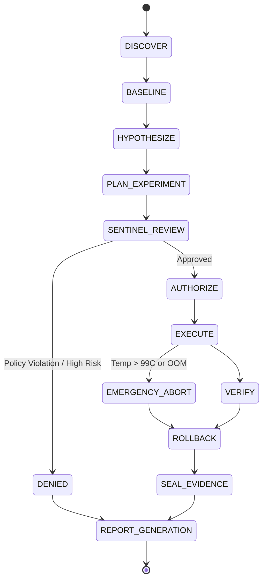

# Architecture Specification: Hardware Research Agent (IHRA)

> This document is a target architecture, not a description of currently enforced guarantees. `core/executor.py` replays fixed synthetic fixtures and can run one pinned CPU-only workload inside a rootless Bubblewrap sandbox. It does not execute proposed experiments, request authorization, access hardware controls, or alter persistent hardware/system state.

## 1. System Overview

The **ISyCo Hardware Research Agent (IHRA)** is a modular, security-hardened Linux framework designed to conduct reproducible, non-destructive hardware research. It decouples the intelligence layer (which formulates hypotheses) from the execution layer (which enforces permissions, monitors invariants, and guarantees rollbacks).

```
 +-------------------------------------------------------------------------+
 |                          PROPOSAL SUBSYSTEM                             |
 |  +-----------------------+                    +----------------------+  |
 |  |  Discovery Engine     |                    |  Hypothesis Ledger   |  |
 |  |  (Read-Only Sysfs)    |                    |  (Falsifiable Claims)|  |
 |  +-----------+-----------+                    +-----------+----------+  |
 |              |                                            |             |
 |              v                                            v             |
 |  +---------------------------------------------------------------+      |
 |  |                     Experiment Planner                        |      |
 |  |         (Generates Target, Matrix, Controls, Rollback)        |      |
 |  +-------------------------------+-------------------------------+      |
 +----------------------------------|--------------------------------------+
                                    | ExperimentPlan JSON
                                    v
 +-------------------------------------------------------------------------+
 |                          SENTINEL GATEKEEPER                            |
 |  +---------------------------------------------------------------+      |
 |  |  Safety Reviewer                                              |      |
 |  |  - Evaluates Risk Tier (0, 1, 2, 3)                           |      |
 |  |  - Verifies Rollback Hook Validity                            |      |
 |  |  - Checks Allowed Operations List                             |      |
 |  |  - Prompts Human User if Tier >= 1                            |      |
 |  +-------------------------------+-------------------------------+      |
 +----------------------------------|--------------------------------------+
                                    | AuthorizationGrant / DENY
                                    v
 +-------------------------------------------------------------------------+
 |                          EXECUTION ENGINE                               |
 |  +-----------------------+                    +----------------------+  |
 |  |  Execution Owner      |                    |  Rollback Controller |  |
 |  |  - Pre-execution check|                    |  - Independent Stack |  |
 |  |  - Whitelist runner   |                    |  - Mandatory Restore |  |
 |  |  - Abort on overheat  |                    |  - Verify State      |  |
 |  +-----------+-----------+                    +-----------+----------+  |
 |              |                                            |             |
 |              v                                            v             |
 |  +-----------------------+                    +----------------------+  |
 |  |  Result Verifier      |                    |  Evidence Recorder   |  |
 |  |  - Triangulation      |                    |  - SHA-256 Manifest  |  |
 |  |  - Hash Math Check    |                    |  - Privacy Redaction |  |
 |  |  - Controls Check     |                    |  - Immutable Logs    |  |
 |  +-----------------------+                    +----------------------+  |
 +-------------------------------------------------------------------------+
```

---

## 2. Core Modules

### 2.1 Hardware Discovery Engine (`core/discovery.py`)
* **Role:** Gathers non-invasive hardware topology.
* **Interfaces:** Sysfs, `/proc`, `/sys/class/hwmon`, `/sys/bus/pci`, ACPI tables.
* **Capabilities:** Emits structured `HardwareInventory` containing CPU architecture, vector flags, active GPUs, NPU devices, memory/ZRAM topology, and active power management frameworks.
* **Safety:** Zero write calls (`O_RDONLY` exclusively).

### 2.2 Tool Capability Registry (`adapters/`)
* **Role:** Encapsulates external command interactions behind typed, capability-checked interfaces.
* **Adapters:**
  * `linux_inventory`: Native sysfs reader.
  * `linux_cpu_perf`: `powerprofilesctl` and `amd_pstate` scaling governor reader/setter.
  * `nvidia_telemetry`: NVML / `nvidia-smi` parser (distinguishes cached vs live data).
  * `amd_xdna_discovery`: NPU device and driver inspector (`/dev/accel/accel0`).
* **Design Rule:** Every adapter must return `CapabilityStatus.NOT_APPLICABLE` when target hardware is absent, preventing spurious errors or cross-device contamination.

### 2.3 Hypothesis Ledger (`core/hypothesis.py`)
* **Role:** Tracks all experimental propositions from creation to formal verdict.
* **Fields:** `hypothesis_id`, `statement`, `target_silicon`, `primary_variable`, `predicted_delta`, `falsification_condition`, `status`.
* **Statuses:** `PROPOSED`, `TESTING`, `DEMONSTRATED`, `REFUTED`, `NOT_DEMONSTRATED`, `NO_SAFE_GAIN_FOUND`, `DENIED`.

### 2.4 Safety & Sentinel Gate (`core/sentinel.py`)
* **Role:** The definitive authorization gatekeeper.
* **Logic:**
  1. Inspects every step in `ExperimentPlan`.
  2. Rejects any plan attempting Tier 3 actions (firmware writes, SMU register writes, thermal threshold overrides, raw PCIe writes).
  3. Rejects any plan where `rollback_plan` is missing or unverifiable.
  4. Demands human user confirmation for Tier 1 or Tier 2 interventions.
  5. Emits an `AuthorizationGrant` with an expiration timestamp and cryptographic token.

### 2.5 Proposed Autonomous Execution Owner (`core/executor.py`)
* **Role:** Executes pre-compiled whitelist actions.
* **Implementation status:** The production execution owner described here is not implemented. The current module provides a fixture replay dry-run and a separate, fixed synthetic CPU workload sandbox; neither executes experiment plans or supports arbitrary workloads.
* **Invariants:**
  * Validates the `AuthorizationGrant` before dispatching any command.
  * Continuously queries thermal and memory sensors during workload execution.
  * Immediately aborts execution if temperature reaches $99\text{ }^\circ\text{C}$ or memory free drops below $500\text{ MB}$.
  * Always invokes `RollbackController` upon completion or abort.

### 2.6 Rollback Controller (`core/rollback.py`)
* **Role:** Independent state restoration conduit.
* **Mechanism:**
  * Captures initial state into an isolated snapshot file.
  * Executes restoration hooks in reverse order of intervention.
  * Performs active verification (re-reads sysfs nodes to confirm state returned to baseline).
  * Returns a signed `RollbackReceipt`.

### 2.7 Result Verifier (`core/verifier.py`)
* **Role:** Anti-fake evaluator and triangulation engine.
* **Validation Steps:**
  1. **Software vs Physical Parity:** Detects cases where software reported unlocked/boosted but physical benchmarks showed no speedup (e.g. the Ada D3cold trap).
  2. **Mathematical Determinism:** Verifies that output buffers match expected SHA-256 hashes across all runs. If hashes diverge, rejects the result as calculation corruption.
  3. **Control Invariance:** Verifies that negative controls remained within $\pm 1\%$ of baseline.
  4. **Statistical Significance:** Rejects "best of N" cherry-picking; requires median and interquartile range (IQR) analysis across at least 3 repetitions.

### 2.8 Evidence Recorder (`core/recorder.py`)
* **Role:** Artifact preservation and privacy sanitization.
* **Function:**
  * Writes raw JSON logs and test telemetry to `evidence/`.
  * Sanitizes personal hostnames, MAC addresses, machine UUIDs, and absolute home directory paths.
  * Computes and writes `SHA256SUMS.txt` covering every recorded file.

---

## 3. Data Flow & State Machine


